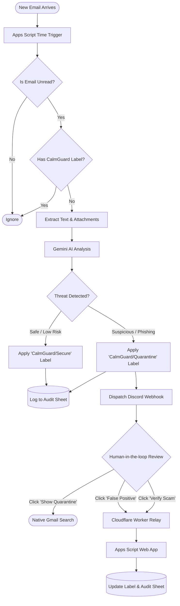

# CalmGuard AI

CalmGuard AI is an automated email threat detection and phishing triage system powered by Google Gemini. Running natively on Google Apps Script, it scans incoming emails, analyzes them for malicious intent or social engineering tactics, and alerts administrators via Discord. 

This repository contains the lightweight, serverless deployment, designed for zero-maintenance operation and mobile-friendly incident response.

## Features

- **Automated Triage:** Continuously monitors unread emails and routes them to `CalmGuard/Quarantine` or `CalmGuard/Secure` labels.
- **Agentic Analysis:** Uses Google Gemini (with a 5-model automatic fallback rotation to prevent 503 limits) to evaluate threats, detect urgency tactics, and identify PII/financial risks.
- **Discord Integration:** Dispatches rich embed alerts to Discord containing threat evidence, confidence scores, and action recommendations.
- **Human-in-the-Loop Controls:** Discord alerts include instant action buttons to mark emails as a *False Positive*, *Verify Scam*, or view the native Gmail Quarantine list.
- **Google Sheets Auditing:** Automatically logs all triaged emails, threat levels, and sandbox tests to a designated Google Sheet.

## 🔄 System Workflow

## 🏗️ Project Architecture

CalmGuard AI operates across a modular, serverless 3-layer architecture:

1. **Google Apps Script (The Brain):** Scans unread emails, parses text/attachments, and orchestrates the AI analysis. It also exposes Web App endpoints (`doGet` / `doPost`) to handle user decisions. The core logic is divided into four modular `.gs` files:
   - `Code.gs`: The core orchestrator. Contains the main `runEmailTriage()` loop, the Gemini API multi-model fallback handler, and the webhook endpoints.
   - `Providers.gs`: The Discord alert dispatcher. Handles formatting the threat analysis into Discord embeds and generating secure action URLs.
   - `prompt.gs`: Contains the system instructions, defining the AI analyst persona and enforcing the structured JSON output schema.
   - `tools.gs`: Houses utility functions, local PII redaction, and simulated external API tool declarations.
2. **Gemini LLM (The Analyst):** Utilizes a multi-model fallback rotation (e.g., `gemini-2.5-flash`, `gemini-2.5-pro`) to ensure high availability and evaluates threats against strict cybersecurity system instructions.
3. **Cloudflare Worker (The Secure Relay):** Acts as a middleman proxy between Discord UI buttons and the Google Apps Script backend. This prevents mobile browser multi-account login errors, speeds up redirects, and hides the raw Apps Script `/exec` URL from the public.
4. **Discord (The UI):** Delivers rich, color-coded embed alerts with direct action buttons for human-in-the-loop triage.
5. **Google Sheets (The Audit Trail):** Maintains a permanent, immutable log of all triaged emails, Sandbox tests, and manual interventions.

## Setup & Deployment

### 1. Google Apps Script Setup
1. **Create a Google Apps Script Project:** Go to [script.google.com](https://script.google.com) and create a new project.
2. **Copy the Source Code:** Create the four `.gs` files (`Code`, `Providers`, `prompt`, `tools`) and paste the code from the `src/` folder of this repository.
3. **Configure Script Properties:** Go to **Project Settings (Gear Icon) > Script Properties** and add the following secure variables:
   - `GEMINI_API_KEY`: Your Google Gemini API key.
   - `TARGET_DESTINATION`: Your Discord Webhook URL.
   - `AUDIT_SHEET_ID`: The ID of the Google Sheet used for logging.
   - `ADMIN_SECRET`: A secure, random token used to authenticate button clicks from Discord.
   - `WEB_APP_URL`: (Add this *after* completing Step 2) The public URL of your Cloudflare Worker.
4. **Deploy as Web App:** Click **Deploy > New deployment**, select **Web app**, set access to "Anyone", and copy the resulting Web App URL for the next step.
5. **Set Triggers:** Click the **Triggers (Clock Icon)** on the left menu and set `runEmailTriage` to run automatically on a time-driven interval (e.g., every 5 minutes).

### 2. Cloudflare Worker Setup
1. Log in to the Cloudflare Dashboard and navigate to **Workers & Pages**.
2. Create a new Worker and paste the code from `cloudflare/worker.js`.
3. In the Worker's **Settings > Variables and Secrets**, add a new variable:
   - `GAS_URL`: The raw `/exec` URL of your deployed Google Apps Script Web App (from Step 1.4).
4. Deploy the Worker. Copy its public `*.workers.dev` URL and paste it into your Google Apps Script `WEB_APP_URL` property.

### 3. Google Sheets Audit Log Setup
1. Create a new Google Sheet.
2. Create two worksheet tabs exactly named: `CalmGuard_Audit_Logs` and `CalmGuard_Sandbox_Logs`.
3. Copy the Sheet ID from the URL (the long string between `/d/` and `/edit`) and save it to your Apps Script `AUDIT_SHEET_ID` property.

## Security Note
This repository contains no hardcoded credentials. All sensitive API keys, webhook URLs, and authentication tokens are securely managed via Google Apps Script's native properties service and Cloudflare Environment Variables.